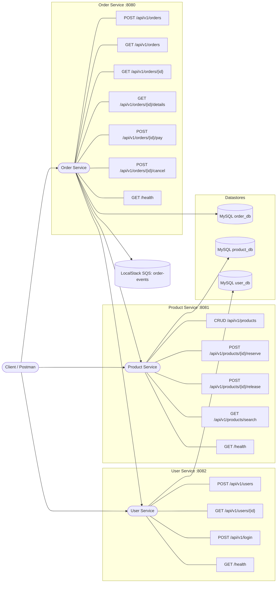

# E-commerce Microservices (Python, Flask, MySQL, SQS)

Services

- order_service (A): REST + MySQL + publishes SQS order events
- product_service (B): REST + MySQL (catalog)
- user_service (C): REST + MySQL (users)

Infra

- 3x MySQL containers
- LocalStack (SQS)
- Docker Compose to orchestrate

Quick start

- docker compose up -d --build
- docker compose logs -f order_service product_service user_service
- docker compose down -v

APIs

- OpenAPI specs in each service under openapi.yaml

# E-commerce Microservices Architecture

This repo contains three Python (Flask) microservices orchestrated with Docker Compose, each with its own MySQL database, plus LocalStack SQS for messaging.

## Architecture (single diagram)

Key behaviors

- Order creation validates user and products, reserves stock, persists order + items, emits SQS event.
- Idempotency: POST /orders supports Idempotency-Key to avoid duplicate orders.
- Status transitions: PENDING → PAID or CANCELLED (cancel releases stock).

---

## DevOps Implementation

### 1. CI/CD with Jenkins

A Jenkins pipeline automates the application build, validation, testing, image publishing, and EC2 deployment.

Pipeline stages include:

1. Checkout source code from Git.
2. Validate required tools and configuration.
3. Build Docker images for all microservices.
4. Start CI services and verify container status.
5. Run automated user-service tests using pytest.
6. Verify CI containers and collect application logs.
7. Authenticate with Amazon ECR and publish service images.
8. Verify AWS Systems Manager connectivity.
9. Deploy the published images to the Ubuntu EC2 instance through SSM.
10. Verify application health and readiness.

**Verification:** Jenkins Build #31 completed successfully, including ECR publishing, SSM connectivity, deployment, and health verification.

### 2. AWS Deployment

The application is deployed to an Ubuntu EC2 instance in the `ap-southeast-2` region.

Deployment components:

- Ubuntu 24.04 LTS EC2 instance.
- Docker and Docker Compose.
- Amazon ECR repositories for user-service, product-service, order-service, and apigateway.
- AWS Systems Manager for remote deployment without SSH access.
- IAM role with the required SSM, ECR pull, and SQS permissions.
- Application Gateway exposed through HTTP port 80.

The Jenkins pipeline publishes uniquely tagged images to ECR and deploys them to the Ubuntu instance through SSM.

### 3. Terraform Infrastructure

Terraform configuration is maintained in the `terraform/` directory.

The configuration manages the AWS infrastructure required by the project, including:

- AWS provider configured for `ap-southeast-2`.
- ECR repositories with image scanning on push.
- Existing application security group configuration.
- Ubuntu EC2 instance and its IAM role and instance profile.
- SSM access and ECR image-pull permissions.
- Encrypted GP3 root volume and IMDSv2 enforcement.

Terraform variables are defined in `terraform/variables.tf`. The current defaults use an existing VPC and public subnet, instance type `t3.small`, and a 16 GB root volume.

Terraform state files and plan files are excluded from Git through `.gitignore`. Do not commit Terraform state files or generated plans.

### 4. Monitoring

The Ubuntu EC2 deployment includes:

| Component | Purpose |
|---|---|
| Prometheus | Collects and stores monitoring metrics |
| Node Exporter | Exposes host-level system metrics |
| Grafana | Monitoring dashboards and visualization |

Monitoring endpoints are available on the instance through Prometheus port `9090`, Node Exporter port `9100`, and Grafana port `3000`. Access should be restricted according to the deployment security requirements.

### 5. Monitoring Failure and Recovery Test

A monitoring failure simulation was performed on the Ubuntu deployment:

1. Stopped the Node Exporter container.
2. Verified that Prometheus reported the Node Exporter target as `DOWN`.
3. Restarted the Node Exporter container.
4. Verified that Prometheus reported the target as `UP` again.

Prometheus and Grafana health endpoints were also checked successfully.

### 6. Deployment Health Verification

The API Gateway exposes health and readiness endpoints:

- `/health` — checks API Gateway health.
- `/ready` — checks application service readiness.

The deployed `/ready` endpoint returned a successful response with the API Gateway and user, product, and order services reporting `ready`.

### 7. Security Audit

A Gitleaks security audit was performed on the repository and its Git history.

The audit findings, scope, limitations, and remediation recommendations are documented in [docs/security-audit.md](docs/security-audit.md).

Architecture and security documentation:

- [Architecture](docs/architecture.md)
- [Security Audit](docs/security-audit.md)

### 8. Operating System Note

The earlier development environment used Amazon Linux. The assignment deployment target was subsequently provisioned using Ubuntu 24.04 LTS. The Jenkins deployment and application readiness verification were performed against the Ubuntu instance.

### 9. Evidence to Include in Submission

Capture and include screenshots of:

- Jenkins successful pipeline execution and console output.
- ECR repositories and published image tags.
- Ubuntu EC2 instance and SSM connectivity.
- Application `/ready` response.
- Docker containers and health status.
- Prometheus and Grafana health.
- Prometheus target status during failure and recovery.
- Linux users, groups, permissions, and installed tools.
- Terraform configuration and validation.
- Gitleaks security audit report.
- GitHub pull request and repository changes.
